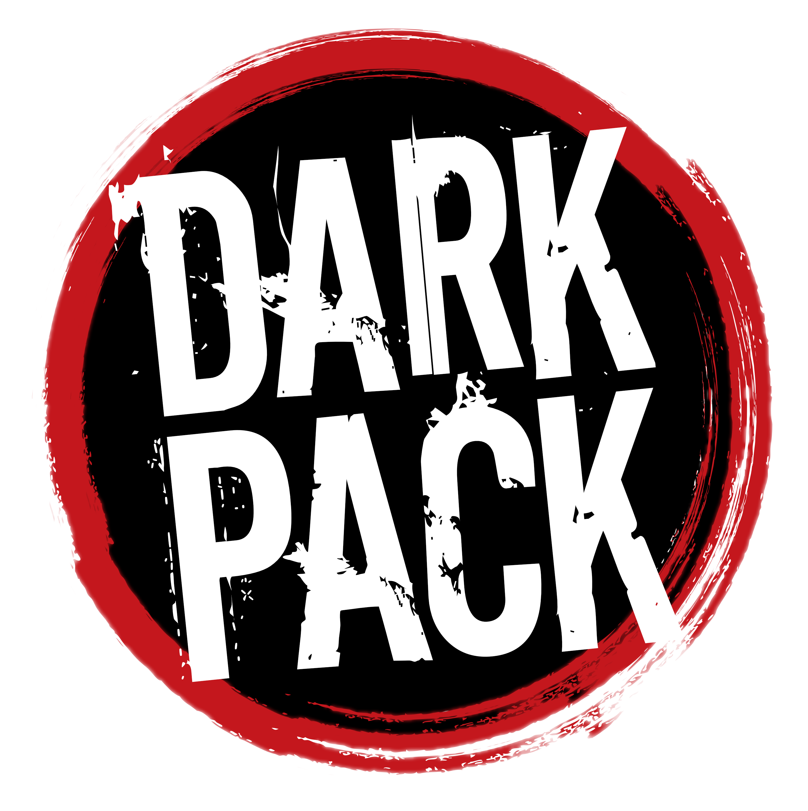

# World of Darkness Revised

Неофициальная система **World of Darkness Revised** для [Foundry VTT](https://foundryvtt.com/).

Сейчас в системе есть лист смертного: портрет и идентичность, здоровье и воля, характеристики, преимущества и статус. Есть броски кубиков с учётом ран и бонусов или штрафов. Интерфейс на русском и английском.

## Установка

В Foundry откройте **Setup → Game Systems → Install System** и вставьте ссылку на манифест в поле **Manifest URL**:

```
https://github.com/himselfego/wod-revised/releases/latest/download/system.json
```

Обновляется система там же, кнопкой **Update**.

Совместимость: Foundry VTT v13 и выше, проверено на v14.

## Разработка

Нужны Node 24 и npm.

```bash
npm install
npm run build        # бандл в dist/
npm test             # тесты
```

`npm run watch` пересобирает бандл при изменениях. Остальные скрипты — `typecheck` и `lint`.

### Проверка в Foundry на своём сервере

`npm run sync` собирает проект и копирует его на сервер по SSH, а `npm run sync:watch` делает это после каждого изменения. Адрес берётся из файла `.sync-target` в корне проекта (в git он не попадает), одна строка вида:

```
user@host:/путь/к/Data/systems/wod-revised
```

При первой установке запустите `node scripts/sync.mjs --init`: он создаст папку на сервере и скопирует `system.json`. Дальше достаточно `npm run sync`. После изменений JS обновите страницу мира (F5), CSS, шаблоны и переводы подхватывает Hot Reload. Если менялся `system.json`, добавьте флаг `--manifest` и перезапустите Foundry.

Релиз собирает GitHub Actions при пуше тега вида `v1.2.3`.

## Dark Pack

<p align="center">
  <a href="https://paradoxinteractive.com/games/world-of-darkness/community/dark-pack-agreement">
    
  </a>
</p>

Проект распространяется по условиям [Dark Pack Agreement](https://paradoxinteractive.com/games/world-of-darkness/community/dark-pack-agreement) и используется только в некоммерческих целях.

**Это неофициальный материал World of Darkness.** _This is not official World of Darkness material._

Portions of the materials are the copyrights and trademarks of Paradox Interactive AB, and are used with permission. All rights reserved. For more information please visit [worldofdarkness.com](https://worldofdarkness.com).
